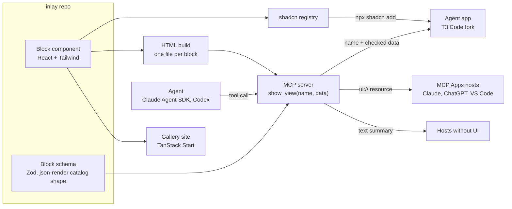
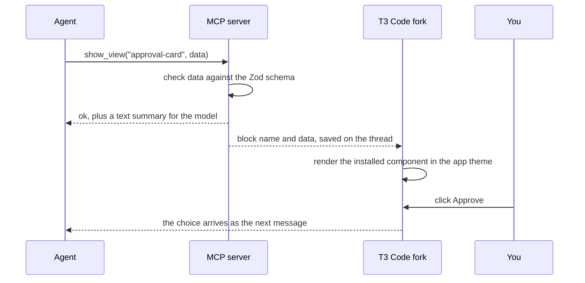
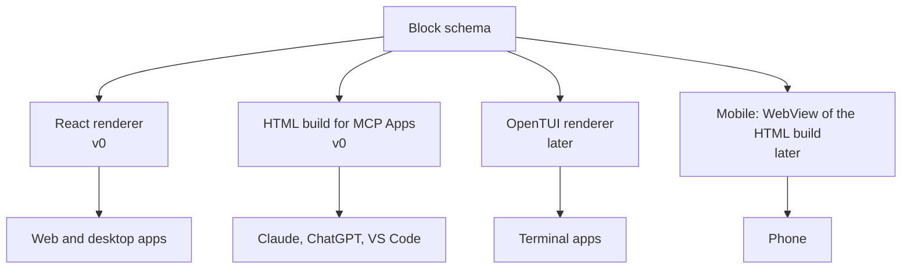
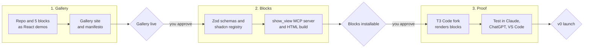

# Inlay: plan

Oct 24, 2026 · @Esaú

## Context

Inlay is an open-source set of UI components that agents show instead of plain chat text. It came out of poteto's poll "is chat the final form of agent ui?", where 72% of 25,074 voters said no.

- Agents already render rich output inside the thread. T3 Code shipped `html_render` on Oct 6, and ChatGPT shipped Intelligent UI with GPT-6 on Oct 7.
- Each app builds those views alone. At least seven T3 Code forks copied `html_render` within weeks, and T3 Code itself has about 7.9k forks.
- shadcn's idea applies: ship small, tested blocks that agents assemble, instead of whole apps.
- Of the six ideas scored in [Agent UI ideas and plan](https://claude.ai/artifact/7iwZhc2ytjAbADC7WSAnoy), this one tied for first at 19 of 25. OpenAI's screen library only works inside ChatGPT, so labs are unlikely to ship an open, cross-harness set.

The project is open source from the first commit. It starts as a side project and may become a startup. Claude builds and Esaú reviews.

## Goal and scope for v0

Ship five blocks that a developer installs with one command and an agent shows with one tool call, proven inside a fork of T3 Code.

**In v0:**

- 5 blocks, each a React component with a Zod schema.
- A registry that the shadcn CLI can install from.
- One MCP tool, `show_view`, that takes a block name and data.
- An HTML build of each block for MCP Apps hosts (Claude, ChatGPT, VS Code).
- A gallery site with a live demo of each block and a short manifesto page stating the project's view: chat is where you state intent, and agents should show the right view for each job.
- A T3 Code fork that renders blocks natively where it used to render raw HTML.

**Not in v0:** terminal and mobile renderers, the forkable shell, paid block sets.

## Architecture

One source per block feeds every output. The React component and its schema live in the repo. The build turns them into a registry entry, an HTML file and a tool definition.

Apps that installed the block render it natively with their own theme. Hosts that only speak MCP Apps get the HTML file, and every other host gets a text summary.

This is one call inside the T3 Code fork:

The agent never writes HTML. It sends data, the server rejects data that doesn't match the schema, and the app draws the block. Clicks on a block go back to the agent as ordinary messages.

## Key decisions

| Decision | Choice | Reason |
| --- | --- | --- |
| Name | Inlay, with Vitrine as the fallback | A view set into the thread, the way an inlay is set into wood. The npm scope @inlay and the packages inlay-ui and create-inlay are free. Vitrine, a display case, is the backup if Inlay runs into a conflict |
| Domain | inlayui.dev, with vitrineui.dev as the fallback | The short domains for both names are taken across .com, .dev, .app, .io, .sh, .ai and .page. inlay.dev is an AI search product, so the ui suffix also keeps the two apart |
| What the agent sends | Data checked against a schema | Raw HTML costs tokens, as T3 Code's issue #17798 shows when agents resend whole pages. Data also lets the app apply its own theme |
| Block source | React + Tailwind | Same stack as T3 Code (React 19, Tailwind 4), and agents write React best |
| Distribution | shadcn registry, code copied into the app | Developers own and edit the code, which fits the fork-first goal |
| Schema format | Zod, in json-render's catalog shape | One schema can later drive terminal (OpenTUI) and mobile renderers |
| Reaching Claude and ChatGPT | HTML build served as an MCP Apps `ui://` resource | MCP Apps is the shared standard since Jan 26, 2026, supported by Claude, ChatGPT, VS Code and Goose |
| Test bed | Fork of T3 Code | Real users, same stack, and `html_render` marks where blocks replace HTML |
| Gallery site | TanStack Start | Server rendering for search and link previews when pages are shared |
| License | MIT | Open source from the first commit |
| Repository | Esaú's GitHub account (esau-morais) | Keeps it personal while it's a side project. It can move to an organization later |

This is how a block reaches each surface over time:

## The first five blocks

Each one answers a need that showed up in the research. I swapped the earlier "inline HTML page" pick for a chart block, because a block should take data, not markup.

| Block | What it shows | Data it takes | Seen in |
| --- | --- | --- | --- |
| `approval-card` | A decision the agent needs, with options and a recommended one | Question, options, recommendation | octomux's permission inbox, Claude Code Agent View |
| `agent-queue` | Jobs waiting, running and done, per worker | Jobs with status, worker and timings | Flo's queue component, Cline Kanban |
| `diff-review` | Changed files grouped by importance, with notes | Files, hunks, severity, notes | Theo's HTML PR reviews |
| `plan-compare` | Two to four options side by side, to pick one | Options with pros, cons and cost | Theo's "several options in one HTML grid" |
| `data-chart` | A line, bar or treemap chart from rows | Rows plus a chart type | T3 Code's visualization demo |

## Milestones

Three stages, each ending in something public. Claude builds every stage, so a stage ends when its check passes and you approve it, not on a date.

Each milestone has a check before the next step starts:

1. **Gallery live.** The five demos work on desktop and phone widths, and the manifesto page is up.
2. **Blocks installable.** `npx shadcn add` installs each block into a fresh Vite app, and an agent in Claude Code can call `show_view` for each one.
3. **v0 launch.** The T3 Code fork shows all five blocks natively, and Claude and ChatGPT show the HTML versions.

## Risks

| Risk | What would show it | Response |
| --- | --- | --- |
| Close competitors (affectui, CopilotKit, json-render) win on reach | Few installs after the gallery launch | Focus on agent-specific blocks they lack, such as queues, approvals and diff review |
| OpenAI or Anthropic open their own block libraries | An announcement | Stay harness-neutral and keep the json-render schema format, so blocks can target their renderers too |
| The T3 Code fork drifts from upstream | Merge conflicts on each upstream release | Keep fork changes in one folder and merge upstream weekly |
| Five blocks are too few to matter | Low gallery traffic | Ask readers which block to build next and ship one a week after v0 |

## Manifesto draft

This is the text for the manifesto page on the gallery site.

### Chat is where you start

Chat is good at one thing. You say what you want.

It is bad at most of what comes after. A plan with four options turns into a wall of text. A diff turns into a list of file names. The one question that needs your yes sits in paragraph six.

People fix this one app at a time. T3 Code renders HTML. ChatGPT draws its own screens. Seven forks copied the same tool in a month. Every team builds the same approval card, alone.

The fix is small. Agents should send data, not markup. Apps should draw that data with parts they own. Those parts should be open, so anyone can copy them, change them and ship them.

Inlay is a set of those parts. One block for each job an agent does. Approve a step. Compare plans. Review a diff. Watch the queue.

Chat stays. You still start there. But the answer should look like the work.

Sources: [Agent UI beyond chat: what people are building](https://claude.ai/artifact/EJ56oasAsGVbZfHtXXoFng), [Agent UI ideas and plan](https://claude.ai/artifact/7iwZhc2ytjAbADC7WSAnoy), [T3 Code issue #17798](https://github.com/pingdotgg/t3code/issues/17798), [MCP Apps build guide](https://ecorpit.com/mcp-apps-server-rendered-ui-extension-build-guide-2026/), [json-render README](https://cdn.jsdelivr.net/gh/vercel-labs/json-render@main/README.md).
